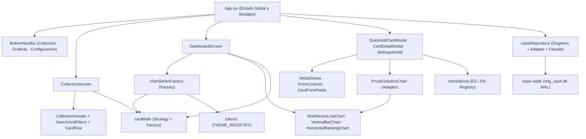

# Arquitectura y Patrones de Diseño

## Visión general por capas

**MTG Vault** sigue una arquitectura *local-first* unidireccional en la que la persistencia SQLite actúa como única fuente de verdad en el dispositivo, mientras las transformaciones financieras y de visualización se mantienen puras, deterministas y fuertemente tipadas.

---

## Catálogo de patrones de diseño aplicados

### 1. Singleton (`DatabaseManager`)

- **Ubicación**: [`DatabaseManager`](../src/db/cardsRepository.ts) en `src/db/cardsRepository.ts`.
- **Motivación**: Evitar condiciones de carrera durante el arranque de la aplicación (cuando `listCards()`, `getAllPriceHistory()` y `getPreferences()` se invocan en paralelo mediante `Promise.all`) y garantizar una única apertura e inicialización transaccional de `mtg_vault.db`.
- **Funcionamiento**:
  - `DatabaseManager.getInstance()` expone la instancia única privada.
  - `getConnection()` almacena la promesa compartida `this.initPromise`; si un fallo transitorio ocurre al abrir SQLite, reinicia `initPromise = null` para permitir reintentos limpios desde el botón *Reintentar*.
  - En la primera ejecución aplica `PRAGMA journal_mode = WAL`, crea tablas e índices si no existen y ejecuta el *seeding* idempotente marcado en `app_meta`.

### 2. Adapter (`CardRecordAdapter` y `PriceEvolutionChart`)

- **Adaptador de persistencia** — [`CardRecordAdapter`](../src/db/cardsRepository.ts):
  - Convierte filas `snake_case` de SQLite (`CardDbRow`) al modelo de dominio `camelCase` (`CardHolding`).
  - Normaliza condiciones (`NM`..`PO`), textos opcionales (`deck`, `orderId`), enteros positivos y cantidades monetarias.
  - Serializa y deserializa series históricas compactas en tuplas JSON `[date, price]` (`parsePointsJson`, `serializePoints`), ahorrando almacenamiento y tiempo de lectura frente a arrays de objetos repetidos.
- **Adaptador gráfico** — [`PriceEvolutionChart`](../src/components/PriceEvolutionChart.tsx):
  - Envuelve al componente genérico [`MultiSeriesLineChart`](../src/components/charts/MultiSeriesLineChart.tsx) adaptando la serie simple `PricePoint[]` de una carta, el formato monetario localizado, la altura compacta (`116dp`), el rango inferior `minYFloor={0}` y la línea de referencia discontinua del coste unitario (`unitCostEur`) usando `computeLineChartYBounds`.
  - Elimina ~350 líneas de lógica SVG duplicada manteniendo fidelidad visual exacta en `CardDetailModal`.

### 3. Strategy + Registry

- **Estrategias de divisa** — `CURRENCY_STRATEGIES` en [`src/utils/cardMath.ts`](../src/utils/cardMath.ts):
  - Desacopla el símbolo y la regla de conversión (`fromEur`) por código de moneda (`EUR`, `USD`) para que `convertFromEur` y `formatAmountInternal` no dependan de condicionales dispersos.
- **Estrategias de filtrado** — `CARD_FILTER_PREDICATES` en [`src/utils/cardMath.ts`](../src/utils/cardMath.ts):
  - Tabla de predicados puros (`all`, `gain`, `loss`, `zeroCost`) evaluada en `O(1)` dentro de `filterAndSortCards`.
- **Registro extensible de temas** — `THEME_REGISTRY` y `resolveTheme()` en [`src/theme/tokens.ts`](../src/theme/tokens.ts):
  - Mapea `ThemeId` al contrato completo `AppTheme`; `SettingsModal` itera dinámicamente las claves registradas (`Object.keys(THEME_REGISTRY)`) para dibujar las opciones de tema y sus muestras de color.
- **Registro de diccionarios i18n** — `ES` / `EN` y `getTranslations()` en [`src/i18n/translations.ts`](../src/i18n/translations.ts).

### 4. Factory

- **Factoría de comparadores** — [`createCardComparator`](../src/utils/cardMath.ts):
  - Construye funciones de comparación tipadas `(a, b) => number` adaptadas al criterio activo (`value`, `profit`, `loss`, `roi`, `name`, `date`) y al idioma activo para `localeCompare`.
- **Factoría de datasets para gráficas** — [`src/utils/chartSeriesFactory.ts`](../src/utils/chartSeriesFactory.ts):
  - Extrae toda la construcción de series de [`DashboardScreen`](../src/screens/DashboardScreen.tsx) en funciones puras y comprobables:
    - `createValueChartData`: serie de mercado vs coste (1 o 5 tiendas).
    - `createProfitChartData`: serie de beneficio neto, línea `0` y techo del rango.
    - `createRoiChartData`: evolución porcentual multitienda.
    - `createTopValuableRankingItems`: barras apiladas Top 20 (coste + ganancia o déficit).
    - `createGainLossRankingItems`: **factoría unificada** parametrizada por `'gain' | 'loss'` y base `'unit' | 'total'` (elimina la duplicación entre Top 10 Ganancia y Top 10 Pérdida).
    - `createMarketIndexChartsData`: normalización Base 100 para índices de coleccionismo, series de juego activo e índice compuesto.
- **Factoría de formularios de carta** — [`createCardFormValues` y `buildCardPayload`](../src/components/shared/CardFormFields.tsx):
  - Inicializa el estado único del formulario tanto para alta (`null`) como para edición (`CardHolding`) con el separador decimal correcto, y valida/normaliza las entradas en un único objeto `NewCardInput`.

### 5. Repository / Facade (`cardsRepository.ts`)

- Expone una interfaz de alto nivel (`listCards`, `insertCard`, `updateCard`, `deleteCard`, `getCardPriceHistory`, `getAllPriceHistory`, `getPreferences`, `savePreferences`) ocultando por completo SQLite, transacciones atómicas (`withTransactionAsync`) y sincronización automática del punto histórico de `Cardmarket` al crear o actualizar el precio de una carta.

### 6. Composición mediante primitivos compartidos (`src/components/shared/`)

- [`ModalSheet`](../src/components/shared/ModalSheet.tsx): shell único para todos los modales inferiores (safe area, `KeyboardAvoidingView`, backdrop, cabecera configurable con *eyebrow* o badge de set, scroll y pie de botones).
- [`FormControls`](../src/components/shared/FormControls.tsx): controles atómicos `SegmentedToggle`, `ChipSelector` y `FormField`.
- [`CardFormFields`](../src/components/shared/CardFormFields.tsx): formulario completo reutilizado tanto en `QuickAddCardModal` como en el modo edición de `CardDetailModal`.

---

## Optimizaciones implementadas

| Área | Optimización aplicada | Impacto |
| :--- | :--- | :--- |
| **Consultas SQLite** | `generateNextCardId()` obtiene todos los IDs con prefijo `CARD-%` en **una única consulta** y resuelve colisiones sobre un `Set` en memoria (en lugar de ejecutar consultas `SELECT` repetidas dentro de un bucle `while`). | Elimina latencia N+1 al insertar cartas. |
| **Búsqueda temporal** | `findLatestPointOnOrBefore()` en [`src/utils/cardMath.ts`](../src/utils/cardMath.ts) utiliza **búsqueda binaria `O(log N)`** para resolver cierres semanales y mensuales. | Escalable cuando crece el histórico diario. |
| **Compresión de series** | Las fechas repetidas por tienda no crean filas SQL por punto; cada pareja `(card_id, source)` almacena una matriz JSON compacta `[yyyy-mm-dd, precio]`. | Base de datos compacta y arranque rápido. |
| **Renderizado de listas y SVG** | `CardRow` está envuelto en `React.memo`; `CollectionScreen` usa `FlatList` virtualizado; `DashboardScreen` memoiza agregaciones pesadas por tienda (`allStoreHistories`) y filtra por sección activa. | Desplazamiento fluido a 60 fps. |
| **Reducción de código duplicado** | Unificación de formularios (`CardFormFields`), modales (`ModalSheet`), adaptador de curva individual (`PriceEvolutionChart`) y slicing temporal genérico (`sliceByDateRange<T>`). | Menor tamaño de bundle y mantenimiento centralizado. |

